# Sistema de RPG — Arquitetura e Persistência

[Português (Brasil)](#português-brasil) · [English](#english)

---

<a name="português-brasil"></a>

## Português (Brasil)

Aplicação full-stack de **Sistema de RPG** construída com foco em **Programação Orientada a Objetos (POO)** e **persistência relacional na Terceira Forma Normal (3FN)** utilizando SQLite. Funciona como um ambiente interativo onde é possível criar heróis, batalhar turno a turno contra monstros, comprar e usar itens em loja com inventário limitado, inspecionar as tabelas reais do SQLite e executar a suíte de 11 testes automatizados.

### Principais Funcionalidades

- **Camada de Domínio Orientada a Objetos (`src/domain/rpg.ts`)**: Separação clara entre entidades de domínio, regras de negócio, persistência e interface.
- **Classes Jogáveis e NPCs**: `Guerreiro`, `Mago` e `Arqueiro` com fórmulas polimórficas de ataque e habilidade especial, além de monstros não jogáveis (`Goblin Saqueador`, `Orc Selvagem`, `Cavaleiro Negro`, `Dragão Ancião`).
- **Combate Turno a Turno e Automático**: Execução interativa por turno (`atacar`, `habilidadeEspecial`, `usarItem`) ou resolução completa do combate com ganho de XP, subida de nível (`nivel * 100`) e recompensa em ouro.
- **Loja e Inventário com Capacidade Limitada**: Valida a capacidade do inventário *antes* de cobrar o ouro (`InventarioCheioError` / `OuroInsuficienteError`) e preserva o item caso o efeito falhe (`PersonagemMortoError`).
- **Persistência Real em SQLite (`src/server/repositorio.ts`)**: Utiliza `node:sqlite` (`DatabaseSync`) nativo do Node.js 22 com `PRAGMA foreign_keys = ON`, transações atômicas, `UPDATE` / `INSERT` explícitos, fábrica polimórfica na leitura e `ON DELETE CASCADE`.
- **11 Testes Automatizados de Borda**: Executados em banco SQLite isolado (`:memory:`) garantindo invariantes de domínio, integridade referencial, IDs sequenciais e proteção contra colisão de nomes entre classes.

---

### Telas do Sistema

#### 1. Arena de Combate e Lista de Heróis
Gerencie heróis salvos no banco, acompanhe barras de HP/MP/XP, invoque monstros do bestiário e lute turno a turno ou no modo automático com registro detalhado de turnos.

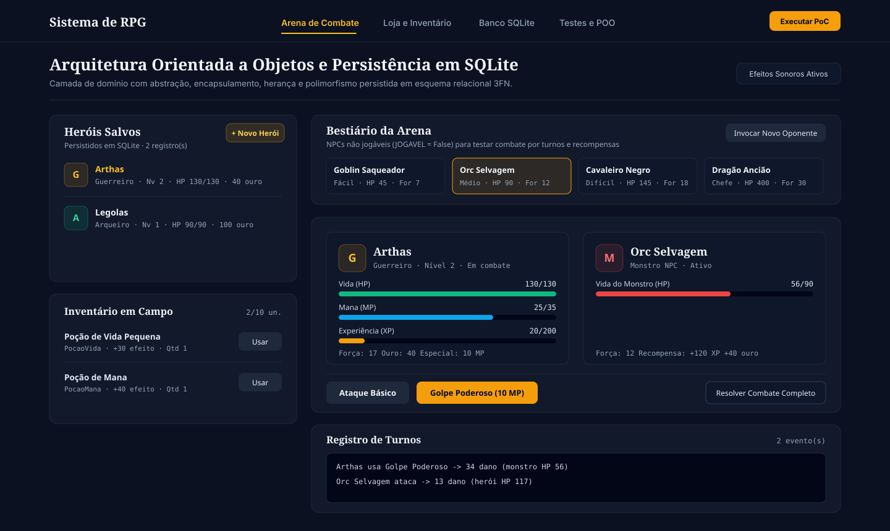

#### 2. Loja, Inventário e Simulador de Exceções
Compre itens do catálogo com validação segura de capacidade e saldo, utilize poções no inventário e teste exceções de domínio diretamente pela interface.

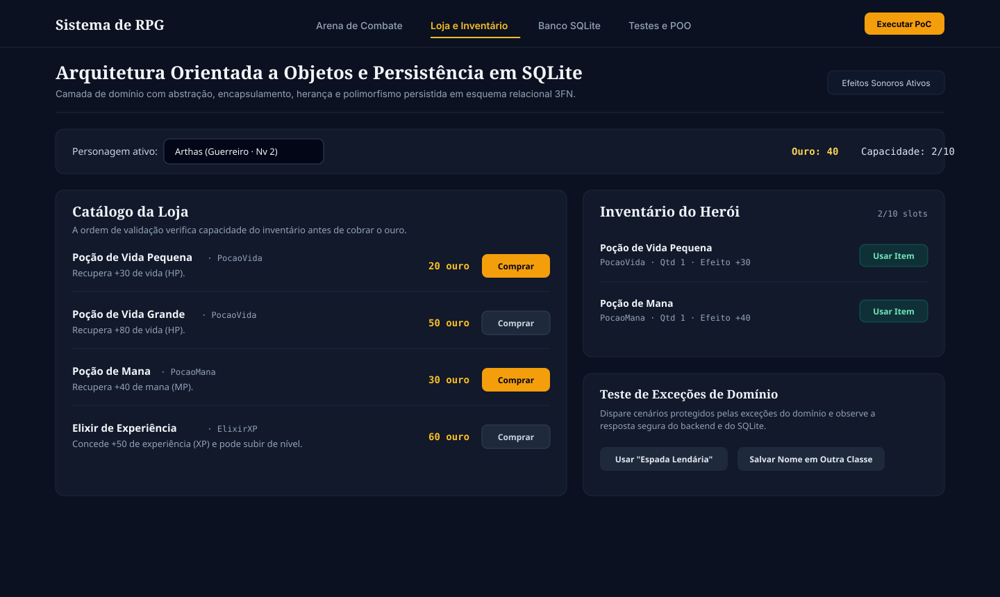

#### 3. Explorador do Banco SQLite (3FN)
Visualize em tempo real os resultados de `SELECT *` nas tabelas `personagens`, `itens` e `inventario` (com `JOIN` legível), além de recriar o banco com a PoC completa.

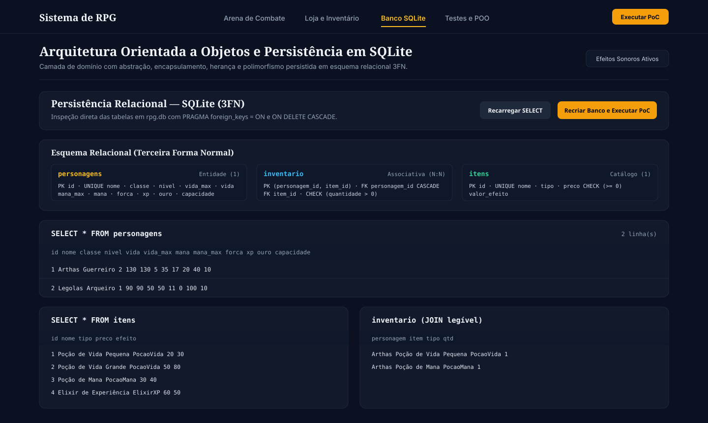

#### 4. Suíte de Testes Automatizados e Arquitetura POO
Execute os 11 testes automatizados em SQLite `:memory:` e explore a hierarquia de classes UML junto aos 4 pilares de POO aplicados no projeto.

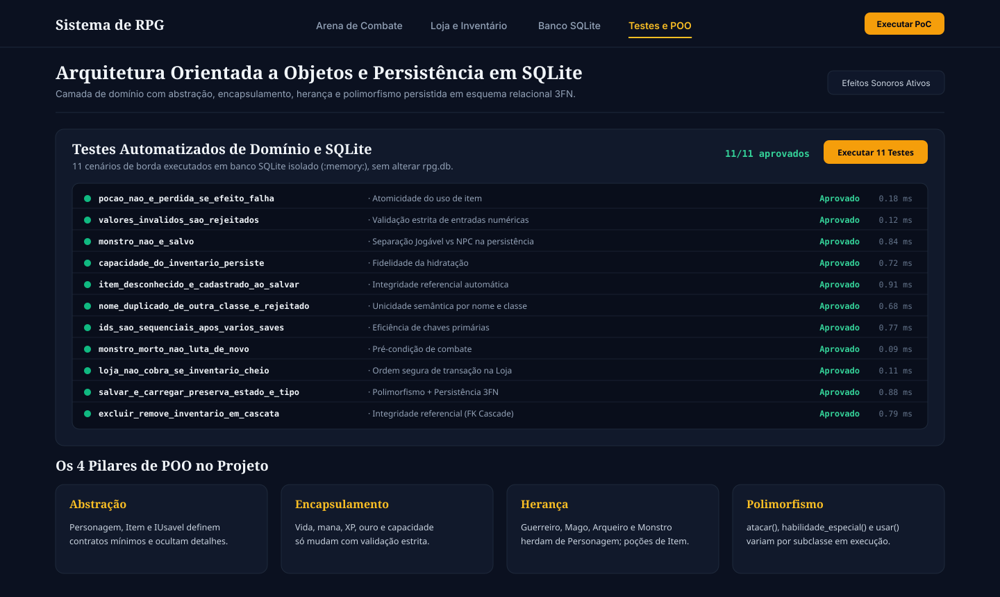

---

### Arquitetura e Pilares de POO

| Pilar | Aplicação no Projeto |
|---|---|
| **Abstração** | `Personagem`, `Item` e `IUsavel` definem contratos abstratos e ocultam detalhes internos de implementação. |
| **Encapsulamento** | Vida, mana, XP, ouro e capacidade são privados/protegidos e só mudam através de métodos validadores (`curar`, `gastarOuro`, `ganharXp`, `receberDano`). |
| **Herança** | `Guerreiro`, `Mago`, `Arqueiro` e `Monstro` herdam de `Personagem`; `PocaoVida`, `PocaoMana` e `ElixirXP` herdam de `Item`. |
| **Polimorfismo** | `atacar()`, `habilidadeEspecial()` e `usar()` têm comportamentos distintos em cada subclasse e são tratados de forma uniforme por `Combate` e `RepositorioRPG`. |

### Diagramas UML (Mermaid)

Os diagramas abaixo são renderizados nativamente em **Mermaid** (também disponíveis em [`docs/uml/diagramas.md`](docs/uml/diagramas.md), em versão vetorial [`docs/uml/*.svg`](docs/uml/01_diagrama_classes.svg) e interativamente na aba **Testes e POO**).

#### Diagrama de Classes


#### Diagrama de Sequência — Compra, Combate e Persistência

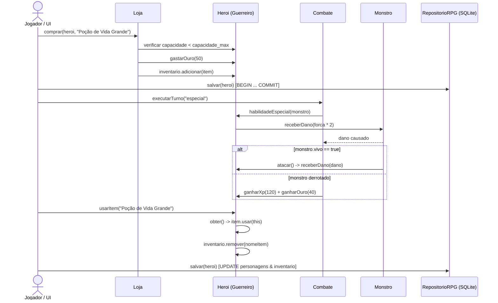

#### Diagrama Entidade-Relacionamento (DER — 3FN)

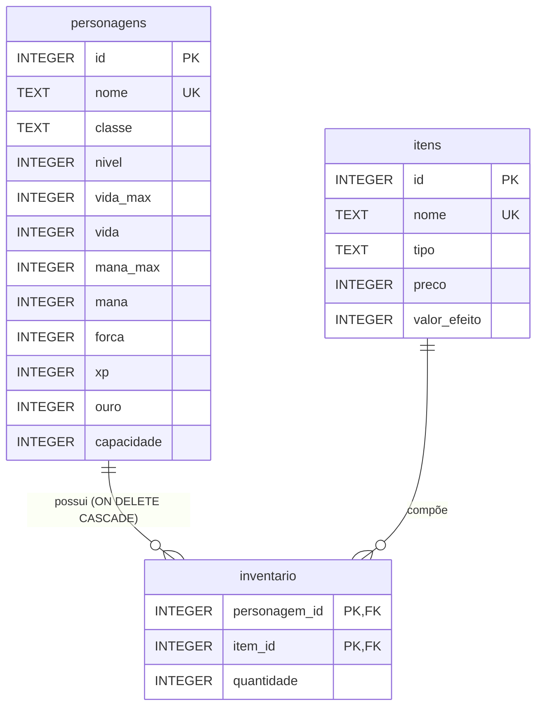

#### Diagrama de Componentes e Arquitetura em Camadas

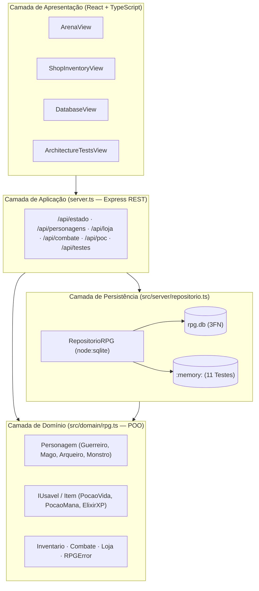

### Modelo Relacional (3FN)

```text
personagens (1) ──────< (N) inventario (N) >────── (1) itens
```

- **`personagens`**: `id` (PK), `nome` (`UNIQUE`), `classe`, `nivel`, `vida_max`, `vida`, `mana_max`, `mana`, `forca`, `xp`, `ouro`, `capacidade`.
- **`itens`**: `id` (PK), `nome` (`UNIQUE`), `tipo` (discriminador da fábrica), `preco` (`CHECK >= 0`), `valor_efeito`.
- **`inventario`**: PK composta `(personagem_id, item_id)`, `quantidade` (`CHECK > 0`), FK `personagem_id` com `ON DELETE CASCADE`, FK `item_id`.

### Exceções de Domínio

Todas as violações de regra de negócio lançam exceções tipadas derivadas de `RPGError`:
- `InventarioCheioError` · `OuroInsuficienteError` · `ItemNaoEncontradoError`
- `ManaInsuficienteError` · `PersonagemMortoError` · `ValorInvalidoError`
- `PersonagemJaExisteError` · `CombateInvalidoError`

### Endpoints da API REST

| Método | Rota | Descrição |
|---|---|---|
| `GET` | `/api/estado` | Retorna heróis salvos, catálogo da loja, bestiário e tabelas SQLite |
| `POST` | `/api/personagens` | Cria e salva um novo herói jogável (`Guerreiro`, `Mago`, `Arqueiro`) |
| `POST` | `/api/personagens/:nome/reviver` | Restaura HP e MP do herói ao máximo |
| `DELETE` | `/api/personagens/:nome` | Exclui o herói do SQLite (`ON DELETE CASCADE` limpa o inventário) |
| `POST` | `/api/loja/comprar` | Compra item validando capacidade antes de descontar ouro |
| `POST` | `/api/personagens/:nome/usar-item` | Usa item do inventário consumindo-o apenas se o efeito tiver sucesso |
| `POST` | `/api/combate/turno` | Executa um turno de combate (`atacar`, `especial`, `usarItem`) |
| `POST` | `/api/combate/auto` | Resolve o combate completo até vitória ou derrota e persiste o resultado |
| `POST` | `/api/poc/executar` | Recria `rpg.db` do zero e executa a PoC completa |
| `POST` | `/api/testes/executar` | Executa os 11 testes automatizados em banco SQLite `:memory:` |

### Tecnologias e Como Executar

- **Frontend**: React 19, TypeScript, Tailwind CSS v4, Lucide Icons, Web Audio API
- **Backend e Persistência**: Node.js 22 (`node:sqlite`), Express, `tsx`, Vite

```bash
# 1. Instalar dependências
npm install

# 2. Iniciar o servidor full-stack (Express + Vite na porta 3000)
npm run dev

# 3. Verificar tipos TypeScript e gerar build de produção
npm run lint
npm run build
```

---

<a name="english"></a>

## English

A full-stack turn-based RPG application built around **Object-Oriented Programming (OOP)** principles and **Third Normal Form (3NF) relational persistence** with SQLite. Designed as an interactive workbench where players can create heroes, battle monsters turn-by-turn, manage shop transactions and bounded inventories, inspect live SQLite tables, and run an automated 11-test verification suite.

### Key Features

- **Layered OOP Domain Engine (`src/domain/rpg.ts`)**: Strict separation between business rules, persistence, and presentation.
- **Playable Classes & NPCs**: `Guerreiro` (Warrior), `Mago` (Mage), and `Arqueiro` (Archer) with polymorphic combat formulas and special abilities, plus non-playable `Monstro` opponents (`Goblin Saqueador`, `Orc Selvagem`, `Cavaleiro Negro`, `Dragão Ancião`).
- **Turn-by-Turn & Auto Combat**: Interactive turn execution (`atacar`, `habilidadeEspecial`, `usarItem`) or full battle resolution with XP leveling (`nivel * 100` threshold) and gold rewards.
- **Shop & Bounded Inventory**: Validates inventory capacity *before* deducting gold (`InventarioCheioError` vs `OuroInsuficienteError`) and preserves potions if usage fails (`PersonagemMortoError`).
- **Real SQLite Persistence (`src/server/repositorio.ts`)**: Powered by Node.js built-in `node:sqlite` (`DatabaseSync`) with `PRAGMA foreign_keys = ON`, atomic transactions, explicit `UPDATE` / `INSERT`, polymorphic object rehydration, and `ON DELETE CASCADE`.
- **11 Automated Edge-Case Tests**: Executed against isolated `:memory:` SQLite instances covering domain invariants, cascading deletes, sequential IDs, and class collision guards.

---

### Screenshots

#### 1. Combat Arena & Hero Roster
Manage saved heroes, inspect HP/MP/XP bars, invoke bestiary opponents, and fight turn-by-turn or resolve full battles with live turn logs.


#### 2. Shop, Inventory & Domain Exception Lab
Purchase items from the catalog with capacity-first validation, consume potions in/out of combat, and trigger protected domain exceptions safely.


#### 3. SQLite 3NF Database Explorer
Inspect live `SELECT *` snapshots of `personagens`, `itens`, and the `inventario` associative table (`JOIN` view), or re-seed the Proof of Concept (`rpg.db`).


#### 4. Automated Test Suite & OOP / UML Architecture
Run all 11 automated tests in `:memory:` SQLite and explore the layered OOP class hierarchy and the 4 pillars applied in the codebase.


---

### Architecture & OOP Pillars

| Pillar | Implementation in the Codebase |
|---|---|
| **Abstraction** | `Personagem`, `Item`, and `IUsavel` define abstract contracts and hide internal state mutations. |
| **Encapsulation** | Health, mana, XP, gold, and inventory capacity are protected/private and mutated only via validating methods (`curar`, `gastarOuro`, `ganharXp`, `receberDano`). |
| **Inheritance** | `Guerreiro`, `Mago`, `Arqueiro`, and `Monstro` extend `Personagem`; `PocaoVida`, `PocaoMana`, and `ElixirXP` extend `Item`. |
| **Polymorphism** | `atacar()`, `habilidadeEspecial()`, and `usar()` exhibit distinct subclass behavior while being handled uniformly by `Combate` and `RepositorioRPG`. |

### UML Diagrams (Mermaid)

The diagrams below render natively in **Mermaid** (also available in [`docs/uml/diagramas.md`](docs/uml/diagramas.md), as vector files [`docs/uml/*.svg`](docs/uml/01_diagrama_classes.svg), and interactively inside the **Testes e POO** tab).

#### Class Diagram

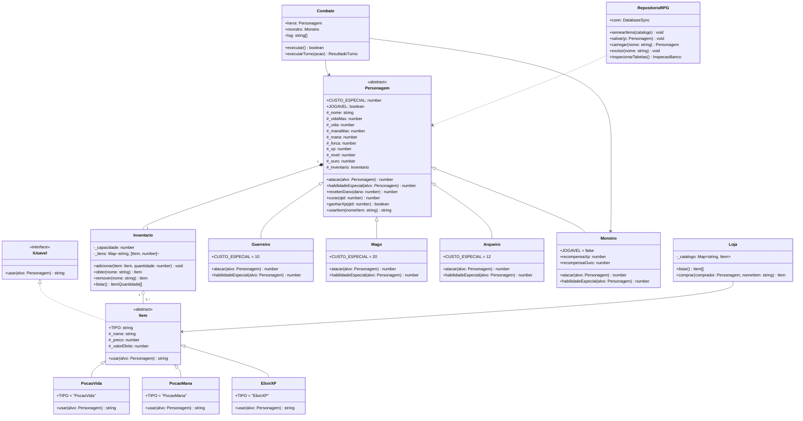

#### Sequence Diagram — Shop, Combat & Persistence

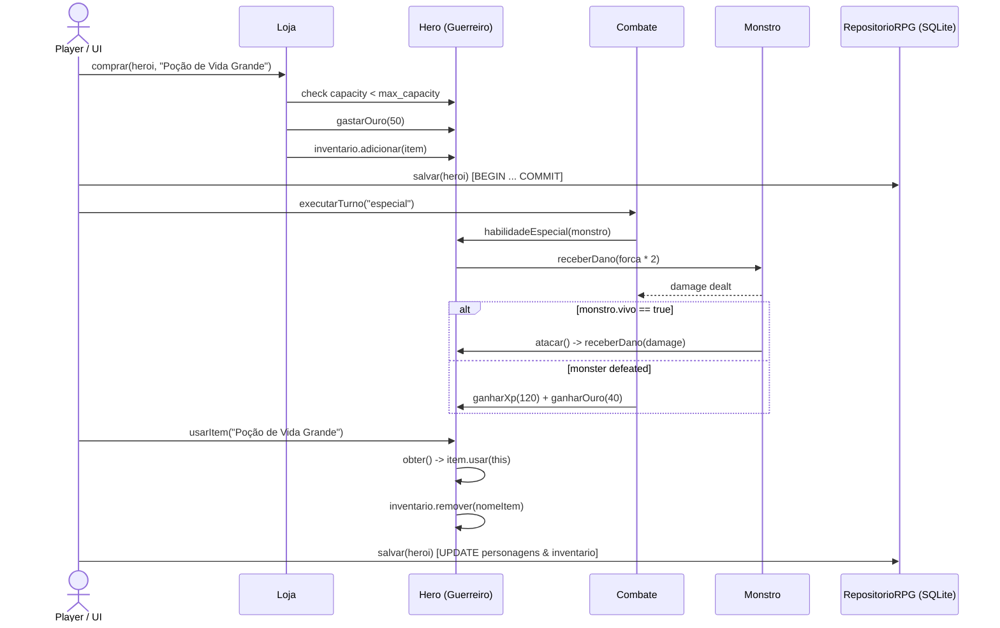

#### Entity-Relationship Diagram (3NF)

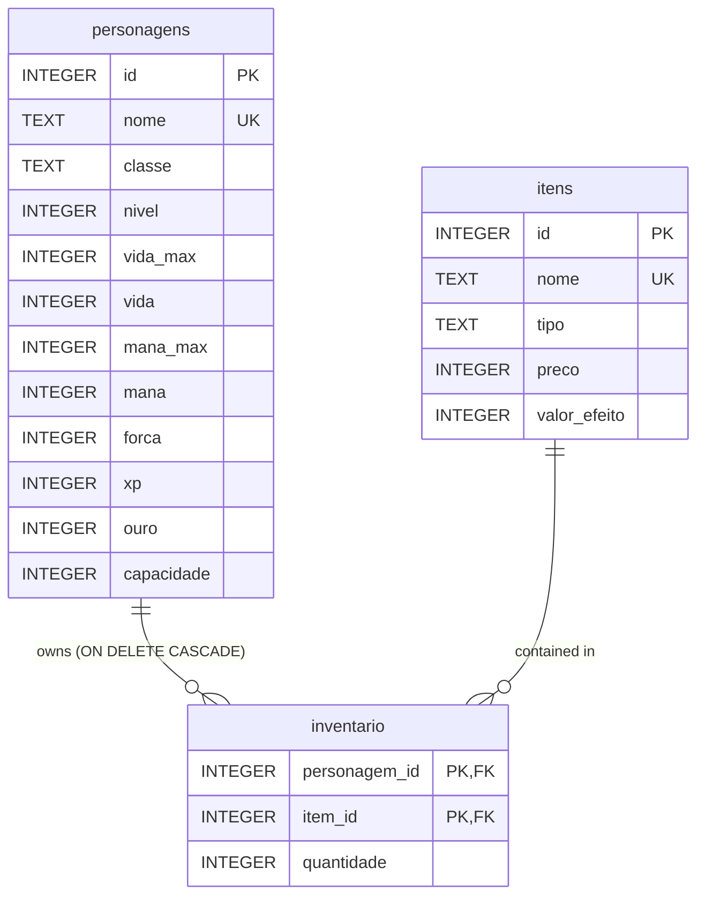

#### Layered Component Architecture

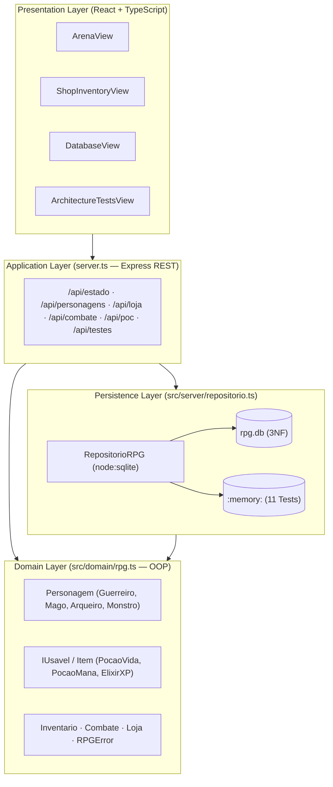

### Relational Schema (3NF)

```text
personagens (1) ──────< (N) inventario (N) >────── (1) itens
```

- **`personagens`**: `id` (PK), `nome` (`UNIQUE`), `classe`, `nivel`, `vida_max`, `vida`, `mana_max`, `mana`, `forca`, `xp`, `ouro`, `capacidade`.
- **`itens`**: `id` (PK), `nome` (`UNIQUE`), `tipo` (factory discriminator), `preco` (`CHECK >= 0`), `valor_efeito`.
- **`inventario`**: Composite PK `(personagem_id, item_id)`, `quantidade` (`CHECK > 0`), FK `personagem_id` with `ON DELETE CASCADE`, FK `item_id`.

### Domain Exceptions

All invalid states raise typed domain exceptions derived from `RPGError`:
- `InventarioCheioError` · `OuroInsuficienteError` · `ItemNaoEncontradoError`
- `ManaInsuficienteError` · `PersonagemMortoError` · `ValorInvalidoError`
- `PersonagemJaExisteError` · `CombateInvalidoError`

### REST API Endpoints

| Method | Endpoint | Description |
|---|---|---|
| `GET` | `/api/estado` | Returns saved heroes, shop catalog, bestiary, and raw 3NF SQLite tables |
| `POST` | `/api/personagens` | Creates and persists a new playable hero (`Guerreiro`, `Mago`, `Arqueiro`) |
| `POST` | `/api/personagens/:nome/reviver` | Restores hero HP/MP to maximum |
| `DELETE` | `/api/personagens/:nome` | Deletes hero from SQLite (`ON DELETE CASCADE` clears inventory) |
| `POST` | `/api/loja/comprar` | Purchases an item with capacity-first & gold validation |
| `POST` | `/api/personagens/:nome/usar-item` | Consumes an inventory item only if the effect succeeds |
| `POST` | `/api/combate/turno` | Executes a single combat turn (`atacar`, `especial`, `usarItem`) |
| `POST` | `/api/combate/auto` | Resolves a complete battle loop and persists rewards |
| `POST` | `/api/poc/executar` | Recreates `rpg.db` and runs the full Proof of Concept |
| `POST` | `/api/testes/executar` | Runs all 11 automated tests on an `:memory:` SQLite database |

### Tech Stack & Getting Started

- **Frontend**: React 19, TypeScript, Tailwind CSS v4, Lucide Icons, Web Audio API
- **Backend & Persistence**: Node.js 22 (`node:sqlite`), Express, `tsx`, Vite

```bash
# 1. Install dependencies
npm install

# 2. Start the full-stack server (Express + Vite on port 3000)
npm run dev

# 3. Type-check and build for production
npm run lint
npm run build
```
