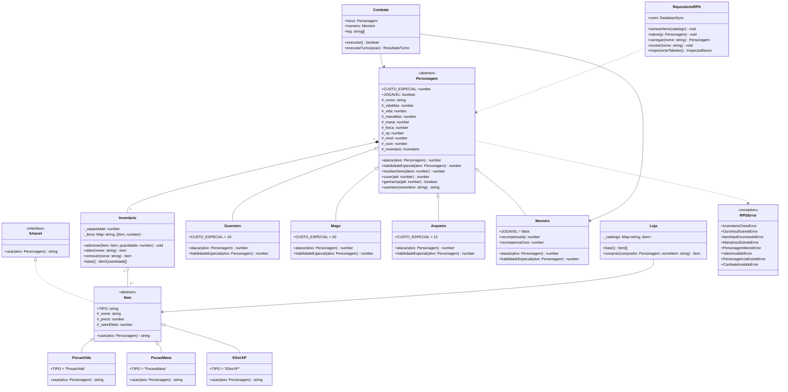
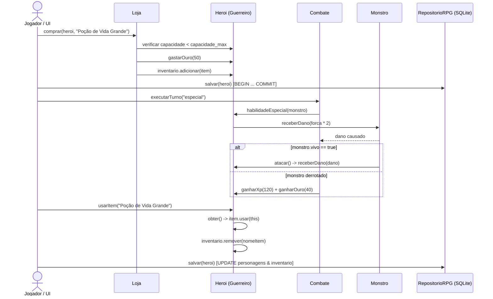
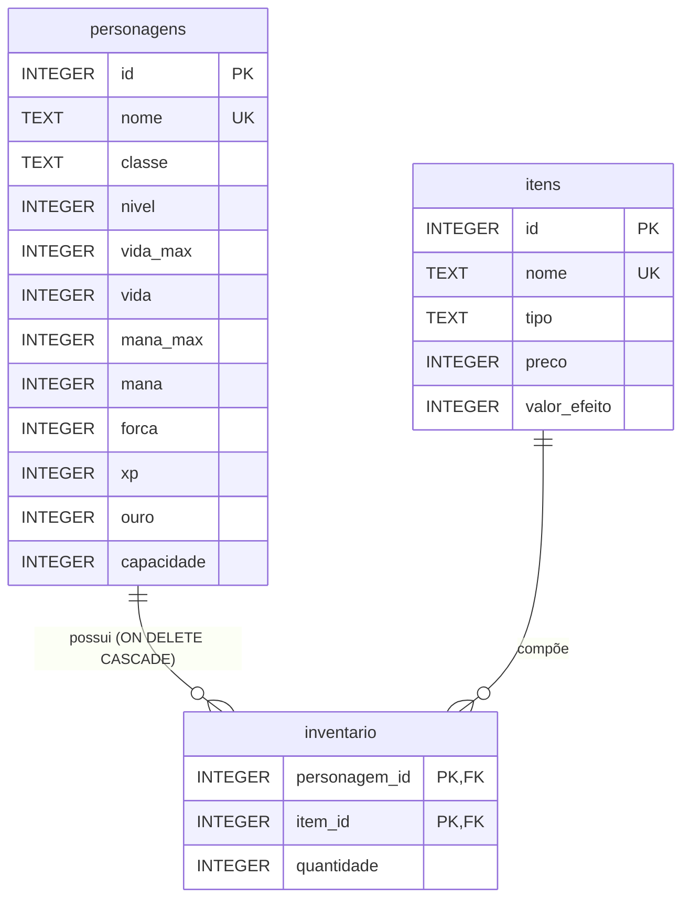
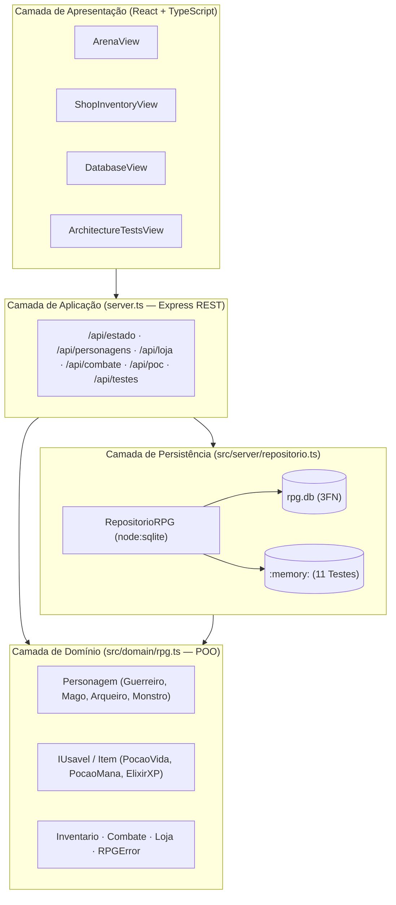

# Diagramas UML — Sistema de RPG (Mermaid)

Este arquivo reúne os 4 diagramas UML do projeto em sintaxe **Mermaid** (compatível com GitHub, GitLab, VS Code, Notion e Mermaid Live Editor).

## 1. Diagrama de Classes

## 2. Diagrama de Sequência — Compra, Combate e Persistência

## 3. Diagrama Entidade-Relacionamento (DER — 3FN)

## 4. Diagrama de Componentes e Arquitetura em Camadas

